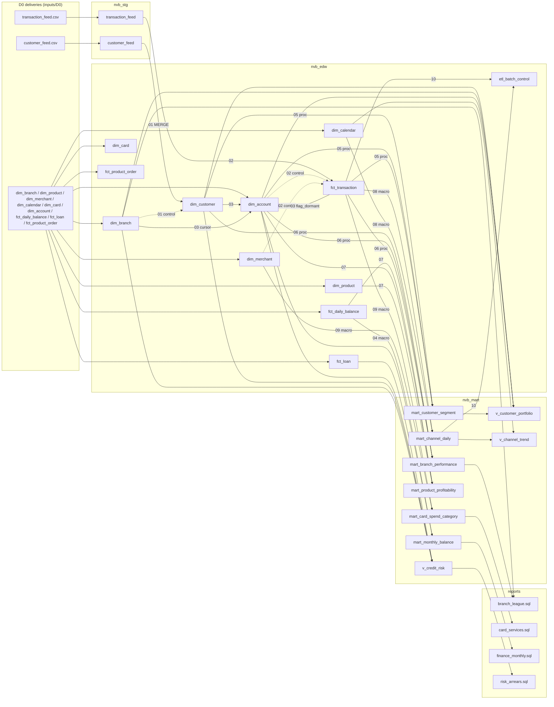
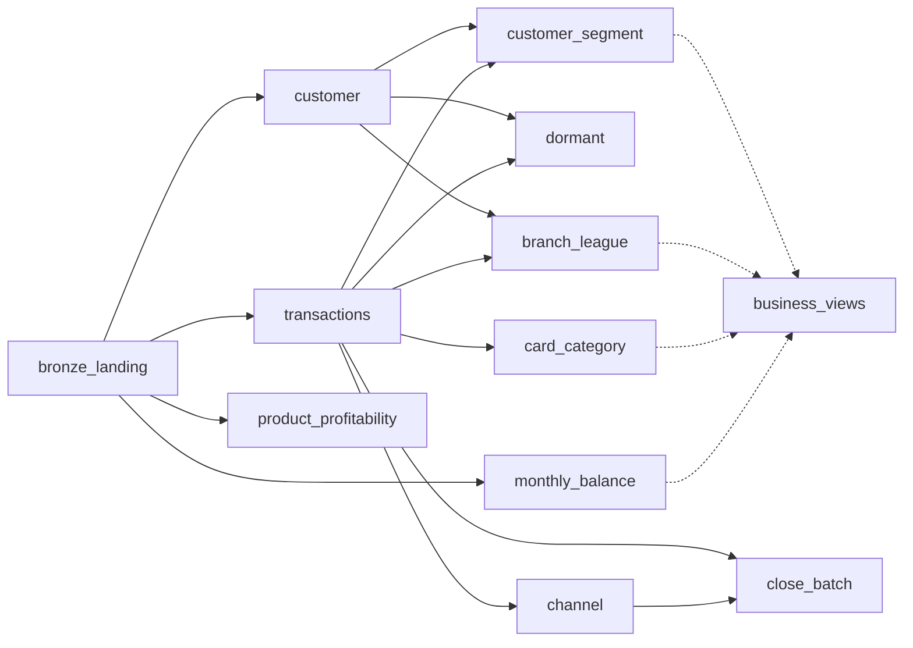

# DAIWT-01 Wave 0 discovery: legacy inventory and dependency graph

Source estate: `Cognition-Partner-Workshops-mirror/daiwt-01-teradata-warehouse` @ `cf4b4fa` (paths below are relative to that repo unless marked *migration repo*).
Target contract: *migration repo* `src/parity/contract.json` (10 outputs, unit names fixed). Golden store: `/Volumes/daiwt_01_mig_prod/landing/golden/` (`manifest.json` capture `20261110T162154Z`, drop `D0`, batch `20250630`, business date `2025-06-30`).

Evidence labels: **[V]** verified by reading source and/or recomputing against the D0 golden inputs/outputs (pandas over `inputs/D0/*/*.parquet` and `outputs/D0/<unit>/*.csv`); **[I]** inference from code reading, not executed (no Teradata instance exists; manifest `source.engine` = "Teradata 17.x (mocked)").

## 1. Estate layout

| area | path | contents |
| --- | --- | --- |
| BTEQ jobs | `legacy/bteq/01_customer.btq` .. `10_close_batch.btq` | 10 nightly scripts (one per scheduled job) |
| procedures | `legacy/procs/{flag_dormant,customer_segment,branch_league}.sql` | 3 SQL stored procedures in `nvb_edw` |
| macros | `legacy/macros/{monthly_balance,channel_daily,card_category}.sql` | 3 macros in `nvb_edw` (`p_from`, `p_to` DATE) |
| views | `legacy/views/{v_credit_risk,v_customer_portfolio,v_channel_trend}.sql` | 3 views in `nvb_mart` |
| DDL | `legacy/ddl/<db>.<table>.sql` | 20 tables: 2 `nvb_stg`, 12 `nvb_edw`, 6 `nvb_mart` |
| schedule | `legacy/schedules/nightly.yaml:1-103`, `legacy/schedules/runbook.md:1-52` | 12 jobs (`upstream`, `01`..`10`, `reconcile`), operator steps |
| reports | `reports/{branch_league,card_services,finance_monthly,risk_arrears}.sql` | 4 consumer SELECTs (not scheduled) |
| delivery generator | `data/generate.py:12-48`, `data/column_defaults.json` | 11 delivery feeds, seed 1704 (`:13`); constant physical attributes per table |
| reference controls | `golden/compute_baselines.py:137-187` | Python `transform()` the D0 goldens were materialized from (manifest `source.statement`) |
| tests | `tests/test_controls.py` | local control tests (no database) |

Header shared by all 10 BTEQ scripts (`:1-24`, byte-identical apart from the step name **[V]** md5 of lines 1-24 with step name masked): `.LOGON ${TD_HOST}/${TD_USER},${TD_PASSWORD}` (`:1`); `SELECT ... FROM nvb_edw.etl_batch_control WHERE batch_date = DATE '2025-06-30' AND job_name = 'NIGHTLY'` (`:8-10`); `INSERT ... VALUES (DATE '2025-06-30','NIGHTLY','OPEN',0)` if absent (`:15-17`); `UPDATE ... SET status='RUNNING', last_step_cd='<step>'` (`:20-22`) with reject if `ACTIVITYCOUNT <> 1` (`:24`). Failure tail of every script: `UPDATE ... SET status='FAILED', last_step_cd='<step>'`, `.QUIT 99` if that update fails, else `.QUIT 12` (e.g. `01_customer.btq:78-87`).

## 2. Tables (DDL)

Every `nvb_edw`/`nvb_mart` table carries the physical delivery columns `batch_id BIGINT NOT NULL DEFAULT 20250630`, `load_ts TIMESTAMP(0) NOT NULL DEFAULT TIMESTAMP '2025-06-30 23:00:00'`, `src_system_cd DEFAULT 'COREBANK'`, `record_status_cd DEFAULT 'A' CHECK IN ('A','D')`, `effective_date DEFAULT DATE '2024-01-01'`, `expiry_date DEFAULT DATE '9999-12-31'` (e.g. `nvb_edw.dim_account.sql:12-17`); constants mirrored in `data/column_defaults.json`. `nvb_stg` tables are all-VARCHAR(80) UNICODE, MULTISET, NO PRIMARY INDEX, NO FALLBACK (`nvb_stg.transaction_feed.sql:1-14`).

| legacy table | DDL | kind / PI / partition | business columns | populated by | read by | D0 rows | target |
| --- | --- | --- | --- | --- | --- | --- | --- |
| nvb_stg.customer_feed | `nvb_stg.customer_feed.sql:1-13` | MULTISET, NoPI | customer_id, customer_name, branch_id, town, updated_at (all VARCHAR) | `upstream` (bulk loader, replace) | `01_customer.btq:35` | 5,100 | bronze.customer_feed |
| nvb_stg.transaction_feed | `nvb_stg.transaction_feed.sql:1-14` | MULTISET, NoPI | transaction_id, account_id, txn_date, amount, channel, merchant_id | `upstream` | `02_transactions.btq:35` | 180,000 | bronze.transaction_feed |
| nvb_edw.dim_branch | `nvb_edw.dim_branch.sql:1-21` | SET, UPI branch_id | branch_id, town; + branch_name, region_cd, branch_type_cd, service_language_cd, branch_status_cd (`:15-19`) | `upstream` (direct) | 01 `:41`, 06 `:33,50`, `flag_dormant.sql:24-26`, `v_credit_risk.sql:21`, `v_customer_portfolio.sql:15`, `reports/branch_league.sql:3` | 8 | bronze + silver.dim_branch |
| nvb_edw.dim_product | `nvb_edw.dim_product.sql:1-22` | SET, UPI product_id | product_id, product_name, annual_rate DECIMAL(6,2) (`:9`) | `upstream` | 07 `:33` | 4 | bronze + silver.dim_product |
| nvb_edw.dim_merchant | `nvb_edw.dim_merchant.sql:1-21` | SET, UPI merchant_id | merchant_id, merchant_name, category | `upstream` | 02 `:41`, 09 `:30`, `card_category.sql:22-23` | 80 | bronze + silver.dim_merchant |
| nvb_edw.dim_calendar | `nvb_edw.dim_calendar.sql:1-20` | SET, UPI calendar_date | calendar_date, month_start, year_no, month_no | `upstream` | 08 `:34`, `channel_daily.sql:24-25`, `v_channel_trend.sql:17` | 547 | bronze + silver.dim_calendar |
| nvb_edw.dim_card | `nvb_edw.dim_card.sql:1-22` | SET, UPI card_id | card_id, account_id, card_type | `upstream` | **none** | 6,000 | bronze.dim_card (orphan, §7) |
| nvb_edw.dim_account | `nvb_edw.dim_account.sql:1-23` | SET, UPI account_id | account_id, customer_id, product_id, opened_date, dormant_flag CHAR(1) | `upstream` (dormant_flag = 'N', README "Nightly processing"); `flag_dormant.sql:19-21,29-43` updates dormant_flag | 02 `:40`, 03 `:30`, 05 `:30`, `flag_dormant`, `customer_segment.sql:40-41`, `branch_league.sql:34-35`, `monthly_balance.sql:27-28`, 07 `:32`, all 3 views | 8,000 | bronze.dim_account -> **silver.dim_account** (contract, unit `dormant`) |
| nvb_edw.dim_customer | `nvb_edw.dim_customer.sql:1-24` | SET, UPI customer_id | customer_id, customer_name VARCHAR(80), branch_id, town VARCHAR(30), updated_at TIMESTAMP(0); + customer_type_cd, residence_country_cd, preferred_language_cd, kyc_status_cd, consent_marketing_ind (`:18-22`) | `01_customer.btq:62-71` MERGE | 03 `:36`, 05 `:29`, 06 `:29`, `flag_dormant.sql:34`, `customer_segment.sql:18,39`, `branch_league.sql:18,33`, `v_credit_risk.sql:20`, `v_customer_portfolio.sql:14` | 5,000 | **silver.dim_customer** (unit `customer`) |
| nvb_edw.fct_transaction | `nvb_edw.fct_transaction.sql:1-25` | MULTISET, PI transaction_id, RANGE_N monthly 2024-01-01..2025-06-30 (`:25`) | transaction_id, account_id, txn_date, amount DECIMAL(18,2), channel, merchant_id; + currency_cd, posting_status_cd, reversal_ind, clearing_scheme_cd (`:19-22`) | `02_transactions.btq:55-62` DELETE+INSERT | 03 `:31`, `flag_dormant.sql:39`, 05 proc, 06 proc, 08 `:29`, `channel_daily.sql:23`, 09 `:29`, `card_category.sql:21`, 10 `:29`, 02 export `:69-71` | 180,000 | **silver.fct_transaction** (unit `transactions`) |
| nvb_edw.fct_daily_balance | `nvb_edw.fct_daily_balance.sql:1-22` | MULTISET, PI account_id, RANGE_N monthly | account_id, balance_date, balance; + balance_type_cd, currency_cd, accrued_interest, reserved_amount | `upstream` (direct ledger) | 04 `:30`, `monthly_balance.sql:26`, 07 `:31` | 4,376,000 | bronze + silver.fct_daily_balance |
| nvb_edw.fct_loan | `nvb_edw.fct_loan.sql:1-23` | MULTISET, PI loan_id | loan_id, account_id, outstanding, arrears_days | `upstream` | `v_credit_risk.sql:18` only | 1,800 | bronze + silver.fct_loan |
| nvb_edw.fct_product_order | `nvb_edw.fct_product_order.sql:1-23` | MULTISET, PI order_id | order_id, customer_id, product_id, order_date, status | `upstream` | **none** | 3,500 | bronze.fct_product_order (orphan, §7) |
| nvb_edw.etl_batch_control | `nvb_edw.etl_batch_control.sql:1-23` | SET, PI batch_date | batch_date, job_name, status, row_count, last_step_cd DEFAULT '10_close_batch', window_start_date DEFAULT 2024-01-01, window_end_date DEFAULT 2025-06-30, reject_count DEFAULT 0, scheduler_group_cd DEFAULT 'NVB_NIGHTLY' (`:7-21`) | every BTEQ header/tail (§1), `10_close_batch.btq:43-46`, proc exit handlers | every BTEQ `:8-10`; 10 export `:52-53` | 1 | **silver.etl_batch_control** (unit `close_batch`) |
| nvb_mart.mart_monthly_balance | `nvb_mart.mart_monthly_balance.sql:1-18` | SET, PI account_id | account_id, month_start, average_balance, closing_balance | `monthly_balance.sql:8-32` | 04 `:43,50-51`, `reports/finance_monthly.sql:2-4` | 144,000 | **gold.mart_monthly_balance** |
| nvb_mart.mart_customer_segment | `nvb_mart.mart_customer_segment.sql:1-19` | SET, PI customer_id | customer_id, txn_count, spend, last_txn_date, segment | `customer_segment.sql:20-47` | 05 `:41,48-49`, `v_customer_portfolio.sql:19` | 5,000 | **gold.mart_customer_segment** |
| nvb_mart.mart_branch_performance | `nvb_mart.mart_branch_performance.sql:1-18` | SET, PI branch_id | branch_id, customer_count, net_amount, league_rank | `branch_league.sql:20-41` | 06 `:41,48-51`, `reports/branch_league.sql:2-4` | 8 | **gold.mart_branch_performance** |
| nvb_mart.mart_product_profitability | `nvb_mart.mart_product_profitability.sql:1-17` | SET, PI product_id | product_id, average_balance, annual_income | `07_product_profitability.btq:45-51` | 07 `:57-58` | 4 | **gold.mart_product_profitability** |
| nvb_mart.mart_channel_daily | `nvb_mart.mart_channel_daily.sql:1-18` | SET, PI txn_date | txn_date, channel, txn_count, net_amount | `channel_daily.sql:8-28` | 08 `:41,48-50`, 10 `:36-37`, `v_channel_trend.sql:18-20` | 2,188 | **gold.mart_channel_daily** |
| nvb_mart.mart_card_spend_category | `nvb_mart.mart_card_spend_category.sql:1-17` | SET, PI category | category, txn_count, spend | `card_category.sql:8-29` | 09 `:41,47-49`, `reports/card_services.sql:2-3` | 4 | **gold.mart_card_spend_category** |

D0 rows: inputs from `inputs/D0/_manifest.json` / parquet, outputs from contract `row_count` and the golden CSVs **[V]**; staging/direct-load rows equal `golden/summary.csv` **[V]**.

## 3. Nightly BTEQ scripts

All dates are literals; no script takes parameters (README "Nightly processing": "business-date literals and procedure arguments must be advanced together"). Every script reads and writes `etl_batch_control` via the header/tail in §1. "Reject" = `.IF ACTIVITYCOUNT > 0 THEN .GOTO rejected` after a TOP 1 control SELECT (status FAILED, `.QUIT 12`).

| job / script | volatile tables | reads | writes | literal dates / args | control SELECTs and reject condition | export |
| --- | --- | --- | --- | --- | --- | --- |
| 01_customer `01_customer.btq` | vt_customer_raw (`:26-36`: TRYCAST/TRIM, U+00A0 -> space via OREPLACE `:30,32`, HASHROW source_hash `:34`); vt_customer (`:48-57`: ROW_NUMBER per customer_id ORDER BY updated_at DESC, customer_name DESC, town DESC, branch_id DESC) | nvb_stg.customer_feed, nvb_edw.dim_branch | nvb_edw.dim_customer MERGE (`:62-71`): MATCHED sets 4 attrs + `batch_id = 20250630`, `load_ts = TIMESTAMP '2025-06-30 23:00:00'` (`:67`); NOT MATCHED inserts 5 business columns, physical columns from DDL defaults | 2025-06-30 (`:10,17,22`) | `:39-46` reject if customer_id NULL/<=0, name NULL/'', updated_at NULL, or branch not in dim_branch | - |
| 02_transactions `02_transactions.btq` | vt_payment (`:26-36`: TRYCAST BIGINT/INTEGER/DATE, `OREPLACE(amount, ',', '.')` -> DECIMAL(18,2), channel `COALESCE(NULLIF(UPPER(TRIM)),''),'ONLINE')`) | nvb_stg.transaction_feed, dim_account, dim_merchant | BT (`:53`); DELETE fct_transaction WHERE txn_date BETWEEN 2024-01-01 AND 2025-06-30 (`:55-56`); INSERT 6 business columns (`:58-62`); ET (`:64`); ABORT on error (`:76-78`) | window 2024-01-01..2025-06-30 (`:43,56`) | `:38-47` reject if id NULL/<=0, amount NULL, date NULL/out of window, unknown account or merchant, channel not in CARD/MOBILE/BRANCH/ONLINE; `:48-50` reject duplicate transaction_id | `control_reports/02_transactions.txt` (`:68-73`): COUNT, SUM(amount), MIN/MAX(txn_date) over fct_transaction |
| 03_dormant `03_dormant.btq` | vt_account_control (`:26-33`: dim_account LEFT JOIN fct_transaction, MAX(txn_date)) | dim_account, fct_transaction, dim_customer | via `CALL nvb_edw.flag_dormant(DATE '2025-06-30')` (`:40`) | 2025-06-30 | `:35-39` reject if account's customer missing; `:42-50` post-check: reject if dormant_flag <> (last_payment NULL or <= ADD_MONTHS(2025-06-30,-6) ? 'Y':'N'); `:53` dormant_flag counts (log only) | - |
| 04_monthly_balance `04_monthly_balance.btq` | vt_month_control (`:26-32`: per account x TRUNC(month): ledger_days, latest_date) | fct_daily_balance, (mart_monthly_balance post-check) | via `EXEC nvb_edw.monthly_balance(DATE '2024-01-01', DATE '2025-06-30')` (`:40`) | 2024-01-01, 2025-06-30 | `:34-39` reject if any account-month lacks its calendar month-end or has ledger_days <> day-of-month of latest date; `:42-47` reject if an account-month is missing in mart or closing_balance NULL; `:50-51` month totals (log) | - |
| 05_customer_segment `05_customer_segment.btq` | vt_customer_control (`:26-32`: customers x COUNT(accounts)) | dim_customer, dim_account | via `CALL nvb_edw.customer_segment(DATE '2025-06-30')` (`:37`) | 2025-06-30 | `:34-36` reject customer_id <= 0; `:39-45` reject if customer missing in mart, spend < 0, segment outside 4 values; `:48-49` segment totals (log) | - |
| 06_branch_league `06_branch_league.btq` | vt_branch_control (`:26-30`: COUNT(*) customers per branch) | dim_customer, dim_branch | via `CALL nvb_edw.branch_league(DATE '2025-06-30')` (`:37`) | 2025-06-30 | `:32-36` reject unknown branch; `:39-45` reject if branch missing, customer_count differs, or league_rank < 1; `:48-51` league listing (log; same SELECT as `reports/branch_league.sql`) | - |
| 07_product_profitability `07_product_profitability.btq` | vt_product_income (`:26-37`: per product AVG(CAST(balance AS DECIMAL(28,6))) over all account-days, MAX(annual_rate); filters record_status_cd = 'A' on balance and account, balance_date window) | fct_daily_balance, dim_account, dim_product | BT (`:43`); DELETE mart_product_profitability WHERE batch_id = 20250630 (`:45`); INSERT average_balance = CAST(precise AS DECIMAL(18,2)), annual_income = CAST(precise * annual_rate / 100 AS DECIMAL(18,2)) (`:47-51`); ET (`:53`) | 2024-01-01..2025-06-30 (`:35`), batch 20250630 (`:45`) | `:39-42` reject annual_rate NULL/<0 or mean NULL; `:57-58` listing (log) | - |
| 08_channel `08_channel.btq` | vt_channel_control (`:26-31`: txn_date x channel COUNT, SUM(amount)) | fct_transaction, dim_calendar | via `EXEC nvb_edw.channel_daily(DATE '2024-01-01', DATE '2025-06-30')` (`:38`) | 2024-01-01, 2025-06-30 | `:33-37` reject txn_date not in calendar; `:40-45` reject missing date x channel or count/amount mismatch; `:48-50` per-channel totals (log) | - |
| 09_card_category `09_card_category.btq` | vt_card_control (`:26-33`: CARD and amount < 0, JOIN merchant, per category COUNT, SUM(-amount)) | fct_transaction, dim_merchant | via `EXEC nvb_edw.card_category(DATE '2024-01-01', DATE '2025-06-30')` (`:38`) | 2024-01-01, 2025-06-30 | `:35-37` reject spend < 0 or NULL category; `:40-44` reject missing category or spend/count mismatch; `:47-49` share of spend (log) | - |
| 10_close_batch `10_close_batch.btq` | vt_close_control (`:26-30`: COUNT, SUM(amount) over fct_transaction, NO PRIMARY INDEX) | fct_transaction, mart_channel_daily | etl_batch_control `status='COMPLETE'`, `last_step_cd='10_close_batch'`, `row_count = payment_count` (`:43-46`, reject if ACTIVITYCOUNT <> 1 `:48`) | 2025-06-30 (`:46,53`) | `:32-42` reject if mart_channel_daily totals differ from fct_transaction totals or are NULL | `control_reports/nightly_release.txt` (`:51-55`): the etl_batch_control row incl. load_ts |

## 4. Procedures, macros, views, reports

### 4.1 Stored procedures (`SQL SECURITY INVOKER`; EXIT HANDLER sets etl_batch_control FAILED + RESIGNAL)

| object | path | args | reads | writes | internal control | invoked by |
| --- | --- | --- | --- | --- | --- | --- |
| nvb_edw.flag_dormant | `procs/flag_dormant.sql:1-52` | as_of_date DATE (NULL -> SIGNAL `:15-17`) | dim_branch (cursor over record_status_cd='A' ORDER BY branch_id `:23-28`), dim_customer `:34-35`, fct_transaction `:39-42` | dim_account: reset all active to 'N' (`:19-21`); per branch set 'Y' where account's customer in that branch AND account_id NOT IN payments with `txn_date > ADD_MONTHS(as_of,-6) AND <= as_of`, status 'A' (`:29-43`); FAILED on error (`:9-11`) | SIGNAL if flagged total > account count (`:48-51`) | 03 `:40` |
| nvb_edw.customer_segment | `procs/customer_segment.sql:1-53` | as_of_date | dim_customer, dim_account (status A), fct_transaction (window `ADD_MONTHS(as_of,-12)+1 .. as_of`, status A `:44-45`) | DELETE mart_customer_segment WHERE batch_id = 20250630 (`:20`); INSERT per active customer: COUNT(txn), debit spend, MAX(txn_date), segment CASE (`:21-47`) | SIGNAL if rows <> active customers (`:50-52`) | 05 `:37` |
| nvb_edw.branch_league | `procs/branch_league.sql:1-47` | as_of_date | dim_customer, dim_account (A), fct_transaction (2024-01-01..as_of, A `:38-39`) | DELETE mart_branch_performance WHERE batch_id = 20250630 (`:20`); INSERT COUNT(DISTINCT customer), ZEROIFNULL(SUM(amount)), RANK() OVER (ORDER BY net DESC) (`:21-41`) | SIGNAL if rows <> distinct active branches of customers (`:44-46`) | 06 `:37` |

### 4.2 Macros (one multi-statement request each; runbook `:43`)

| object | path | reads | writes | invoked by |
| --- | --- | --- | --- | --- |
| nvb_edw.monthly_balance(p_from, p_to) | `macros/monthly_balance.sql:1-33` | fct_daily_balance INNER JOIN dim_account (both status A), balance_date BETWEEN p_from AND p_to | DELETE month_start BETWEEN TRUNC(p_from) AND TRUNC(p_to) (`:8-9`); INSERT average = CAST(AVG(CAST(balance AS DECIMAL(28,6))) AS DECIMAL(18,2)), closing = MAX(balance on calendar month-end) (`:18-25`) | 04 `:40` |
| nvb_edw.channel_daily(p_from, p_to) | `macros/channel_daily.sql:1-29` | fct_transaction INNER JOIN dim_calendar, status A | DELETE txn_date BETWEEN p_from AND p_to (`:8-9`); INSERT txn_date, `COALESCE(NULLIF(TRIM(channel),''),'ONLINE')`, COUNT(*), ZEROIFNULL(SUM(amount)) (`:18-28`) | 08 `:38` |
| nvb_edw.card_category(p_from, p_to) | `macros/card_category.sql:1-30` | fct_transaction INNER JOIN dim_merchant; CARD, amount < 0, both status A (`:24-28`) | DELETE WHERE batch_id = 20250630 (`:8-9`, independent of p_from/p_to); INSERT `COALESCE(m.category,'UNCLASSIFIED')`, COUNT, SUM(-amount) (`:17-29`) | 09 `:38` |

### 4.3 Views (`nvb_mart`; none is referenced by any BTEQ script or nightly.yaml job)

| view | path | reads | used by |
| --- | --- | --- | --- |
| v_credit_risk | `views/v_credit_risk.sql:1-23` | fct_loan (A), dim_account, dim_customer, dim_branch; per customer exposure, worst arrears, impaired_ratio (>=90 days), watchlist (30-89), risk_band | `reports/risk_arrears.sql:2-3` |
| v_customer_portfolio | `views/v_customer_portfolio.sql:1-22` | dim_customer (A), dim_branch (branch_name, region_cd), dim_account (A), mart_customer_segment; `MAX(c.load_ts)` as customer_delivery_ts (`:13`) | **no report** (orphan) |
| v_channel_trend | `views/v_channel_trend.sql:1-21` | dim_calendar LEFT JOIN mart_channel_daily with channel literal 'MOBILE' (`:7,20`); CSUM / MAVG(7) (`:10-11`); window 2024-01-01..2025-06-30 (`:21`) | **no report** (orphan) |

### 4.4 Reports (consumer SELECTs; not invoked by the schedule)

| report | path | consumer | reads | notes |
| --- | --- | --- | --- | --- |
| branch_league | `reports/branch_league.sql:1-4` | Regional branch managers | mart_branch_performance JOIN dim_branch | identical columns/order to 06 log SELECT `06_branch_league.btq:48-51` |
| card_services | `reports/card_services.sql:1-3` | Card Services | mart_card_spend_category | `spend/NULLIFZERO(SUM(spend) OVER ())` share, ORDER BY spend DESC |
| finance_monthly | `reports/finance_monthly.sql:1-4` | Finance Control | mart_monthly_balance | `SUM(closing_balance)`, `SUM(average_balance)` per month_start, literal `EXTRACT(YEAR FROM month_start)=2025` |
| risk_arrears | `reports/risk_arrears.sql:1-3` | Credit Risk | v_credit_risk | `impaired_ratio > 0` ORDER BY exposure DESC |

No golden output exists for any report or view (contract has 10 table outputs, no `gold.report_*` entries; *migration repo* `src/parity/contract.json`) **[V]**.

## 5. Schedule and off-workflow steps

`nightly.yaml`: Europe/Oslo (`:1`), business_date `'2025-06-30'` (`:2`), `concurrency: 1` (`:4`), release SLA 03:00 (`:5`), `on_failure: hold_descendants_and_page_owner` (`:6`), lock `nvb_nightly_exclusive` (`:7`), retention request_logs 90 / control_reports 400 days (`:8-10`). Strict linear chain; every BTEQ job `accepted_return_codes: [0]`.

| job | lines | start / SLA | depends_on | owner | script | restart scope |
| --- | --- | --- | --- | --- | --- | --- |
| upstream | `:12-17` | 00:30 / 00:55 | - | Core Banking Operations | **none** (bulk loader, runbook `:5`) | replace direct upstream tables + raw deliveries; verify manifest |
| 01_customer | `:18-25` | 01:00 / 01:10 | upstream | Customer Data Operations | `01_customer.btq` | rerun merge from retained delivery |
| 02_transactions | `:26-33` | 01:10 / 01:25 | 01_customer | Payments Data Operations | `02_transactions.btq` | full retained window |
| 03_dormant | `:34-41` | 01:25 / 01:30 | 02 | Deposit Operations | `03_dormant.btq` | all active accounts |
| 04_monthly_balance | `:42-49` | 01:30 / 01:50 | 03 | Finance Control | `04_monthly_balance.btq` | all month partitions |
| 05_customer_segment | `:50-57` | 01:50 / 02:00 | 04 | Customer Insight | `05_customer_segment.btq` | full population |
| 06_branch_league | `:58-65` | 02:00 / 02:10 | 05 | Branch Operations | `06_branch_league.btq` | all branches |
| 07_product_profitability | `:66-73` | 02:10 / 02:20 | 06 | Product Finance | `07_product_profitability.btq` | one transaction |
| 08_channel | `:74-81` | 02:20 / 02:25 | 07 | Digital Operations | `08_channel.btq` | date partitions |
| 09_card_category | `:82-89` | 02:25 / 02:30 | 08 | Card Services | `09_card_category.btq` | category totals |
| 10_close_batch | `:90-97` | 02:30 / 02:40 | 09 | Data Operations | `10_close_batch.btq` | only after all prior pass |
| reconcile | `:98-103` | 02:40 / 03:00 | 10 | Finance Control | **none** | withhold publication until control reports signed off |

Off-workflow / runbook-only steps (no script in the repo):

| step | source | migration treatment |
| --- | --- | --- |
| `upstream` load of 2 staging feeds + 9 direct tables (replace, header skipped, UTF-8, file-order mapping) | `nightly.yaml:12-17`; README "Systems and ownership"; runbook `:5` | `bronze_landing` (copy `inputs/D0/*` from `landing.golden` to `landing.bronze_landing`/bronze tables) |
| confirm deposit-ledger and payment-clearing deliveries share the business date | runbook `:3-5` | orchestration pre-check (batch_id/business_date of the drop) |
| table DDL at installation only; deploy macros/procs before BTEQ | runbook `:6`; README "Systems and ownership" | `sql_macros` + bundle schemas |
| render TD_HOST/TD_USER/TD_PASSWORD placeholders | README "Nightly processing"; runbook `:8` | not applicable (UC + job identity) |
| create `control_reports/` directory | README "Physical delivery contract"; runbook `:22` | orchestration (volume path for 02/10 control exports, if retained) |
| capture stdout / ERROROUT to request log | runbook `:23` | job run logs |
| `reconcile` / Finance Control sign-off before publishing reporting connection | `nightly.yaml:98-103`; runbook `:11,17` | parity gate + prod promotion in CI (*migration repo* `README.md`) |
| retain control files 400 days with manifest | runbook `:24-25`; `nightly.yaml:10` | out of scope for D0 |
| `make setup` / `make reset [S3=...]` delivery generation | `Makefile:2-14`; README "Export files and controls" | used only for golden capture (manifest `source.legacy_run`) |
| reports (4) | `reports/*.sql` | Wave 3 business views |

Not invoked by any job: views (3), reports (4). All 3 procedures and 3 macros are invoked (03/05/06 `CALL`, 04/08/09 `EXEC`) **[V]**.

## 6. Dependency graphs

### 6.1 Object lineage (feeds -> nvb_stg -> nvb_edw -> nvb_mart -> views -> reports)

`dim_card` and `fct_product_order` have no outgoing edge (§7). Every BTEQ script also reads/writes `etl_batch_control` (header/tail, §1); only the 10 -> etl_batch_control edge is drawn.

### 6.2 Legacy job DAG (incl. off-workflow)

```mermaid
graph LR
  make["make setup / reset (generator; off-schedule)"] -.-> upstream
  install["DDL install + macro/proc deploy (runbook :6)"] -.-> j01
  ctrl_dir["create control_reports/ (runbook :22)"] -.-> j02
  upstream["upstream 00:30 (bulk loader, no script)"] --> j01[01_customer] --> j02[02_transactions] --> j03[03_dormant] --> j04[04_monthly_balance] --> j05[05_customer_segment] --> j06[06_branch_league] --> j07[07_product_profitability] --> j08[08_channel] --> j09[09_card_category] --> j10[10_close_batch] --> reconcile["reconcile 02:40 (sign-off, no script)"]
  j02 -.->|02_transactions.txt| reconcile
  j10 -.->|nightly_release.txt| reconcile
  reconcile -.-> publish["publish reporting connection -> reports/*.sql, views"]
```

### 6.3 Data dependencies between contract units (what the schedule's linear chain actually needs)

| unit | data inputs (legacy) | depends_on (proposed) |
| --- | --- | --- |
| customer | customer_feed, dim_branch | bronze_landing |
| transactions | transaction_feed, dim_account (ref), dim_merchant | bronze_landing |
| dormant | dim_account (ref), fct_transaction, dim_customer, dim_branch | customer, transactions |
| monthly_balance | fct_daily_balance, dim_account (record_status_cd only) | bronze_landing |
| customer_segment | dim_customer, dim_account, fct_transaction | customer, transactions |
| branch_league | dim_customer, dim_account, fct_transaction | customer, transactions |
| product_profitability | fct_daily_balance, dim_account, dim_product | bronze_landing |
| channel | fct_transaction, dim_calendar | transactions |
| card_category | fct_transaction, dim_merchant | transactions |
| close_batch | fct_transaction, mart_channel_daily | transactions, channel |

The legacy chain (`nightly.yaml` `depends_on`) is stricter than the data graph [I]: e.g. 02 does not read dim_customer, and 04/07 do not read anything 01-03 produce except `dim_account.record_status_cd` (unchanged by 03). The marts read `dim_account` columns other than dormant_flag only, so no gold unit depends on `dormant` [V by reading every reader in §2]. `close_batch` is the only silver output with a gold dependency.

## 7. Orphans and unpopulated columns

| item | evidence | status |
| --- | --- | --- |
| nvb_edw.dim_card (6,000 rows) | no reader in bteq/procs/macros/views/reports (grep) | orphan table; land in bronze only |
| nvb_edw.fct_product_order (3,500 rows) | no reader | orphan table; land in bronze only |
| nvb_edw.fct_loan | read only by `v_credit_risk` -> `reports/risk_arrears.sql` | report-only lineage; no contract output |
| v_customer_portfolio, v_channel_trend | no report or job references them | orphan views |
| `etl_batch_control.window_start_date`, `window_end_date`, `reject_count`, `scheduler_group_cd` | never in any INSERT/UPDATE (`01_customer.btq:15-22`, `10_close_batch.btq:43-46`); values come from DDL defaults (`nvb_edw.etl_batch_control.sql:17-21`) | default-only; golden row = `2024-01-01, 2025-06-30, 0, NVB_NIGHTLY` [V] |
| physical columns on every BTEQ-written table (`batch_id`, `load_ts` except dim_customer MATCHED, `src_system_cd`, `record_status_cd`, `effective_date`, `expiry_date`, plus extras e.g. `fct_transaction.currency_cd/posting_status_cd/reversal_ind/clearing_scheme_cd`, `dim_customer.customer_type_cd..consent_marketing_ind`) | INSERT column lists name business columns only (`02_transactions.btq:58-59`, `01_customer.btq:68-69`, `07_product_profitability.btq:47-48`, procs/macros INSERT lists) | DDL-default-only; golden values equal `data/column_defaults.json` [V] |
| `vt_customer_raw.source_hash` | computed `01_customer.btq:34`, not selected into vt_customer (`:50`) | computed, never used |
| columns never read downstream | `dim_account.opened_date`, `dim_product.product_name`, `dim_merchant.merchant_name`, `fct_transaction.posting_status_cd/reversal_ind/clearing_scheme_cd`, `dim_card.*`, `dim_calendar.year_no/month_no/month_start` (only `v_channel_trend`), `dim_branch.branch_name/region_cd` (only `v_customer_portfolio`) | carried through for parity where in contract columns |
| `COALESCE(m.category,'UNCLASSIFIED')` | `card_category.sql:18` after INNER JOIN `:22-23`; D0 merchants all have category (4 values) [V] | value does not occur in D0 |
| channel default `'ONLINE'` | `02_transactions.btq:33`, `channel_daily.sql:20`; D0 feed has 0 blank channels [V] | not exercised in D0 |

## 8. Semantics to preserve (verified against D0)

| semantic | source | D0 evidence [V] |
| --- | --- | --- |
| Latest customer record per id, ties by name, town, branch DESC | `01_customer.btq:52-56`; `compute_baselines.py:110` | feed 5,100 rows / 5,000 ids -> dim_customer 5,000; 100 older 2024-01-01 "Voss" rows (`generate.py:22-25`) superseded |
| Dormant = no active payment with `txn_date > ADD_MONTHS(as_of,-6)` (first recent date 2024-12-31) | `flag_dormant.sql:37-43`; runbook `:48-50` | dim_account Y = 105, N = 7,895; 100 Y are accounts 7901-8000 with no payments (`generate.py:31` draws 1..7900), 5 have last payment <= 2024-12-30; matches 03 post-check formula `03_dormant.btq:45-48` |
| Segment: DORMANT if last < as_of - 90 (2025-04-01) or none; PREMIUM >= 50 txns and >= 20,000 debit spend; ACTIVE >= 20; else OCCASIONAL; window 2024-07-01..2025-06-30 | `customer_segment.sql:30-38,44`; runbook `:50-51` | OCCASIONAL 2,391, ACTIVE 2,327, PREMIUM 221, DORMANT 61 |
| Monthly average = AVG over DECIMAL(28,6) cast to DECIMAL(18,2); closing = month-end balance | `monthly_balance.sql:21-25` | 144,000 = 8,000 accounts x 18 months; 0 account-months where 6-dp-then-2-dp half-up rounding differs from exact half-up |
| Product mean is over all account-days (not mean of account means); income = mean x annual_rate / 100 | `07_product_profitability.btq:29,50` | 4 rows; recomputed income equals golden for all 4 (e.g. product 4: 79,159.60) with either exact or 6-dp mean |
| League rank = RANK() over net_amount DESC | `branch_league.sql:32` | ranks 1..8, no ties |
| Channel daily over INNER JOIN calendar | `channel_daily.sql:24-25` | 2,188 = 547 days x 4 channels |
| Card spend = SUM(-amount) for CARD debits, per merchant category | `card_category.sql:19-26` | 4 categories (FUEL 4,632 txns, GROCERY 4,799, RETAIL 4,691, TRAVEL 4,609) |
| Batch row COMPLETE, row_count = fct_transaction count | `10_close_batch.btq:43-46` | golden `2025-06-30,NIGHTLY,COMPLETE,180000,...,10_close_batch,2024-01-01,2025-06-30,0,NVB_NIGHTLY` |
| `load_ts` excluded from parity | golden `manifest.json` `excluded_from_parity` | constant `2025-06-30 23:00:00`, 10 tables |
| All `record_status_cd` filters are no-ops in D0 | procs/macros/07 `'A'` filters | every input table 100% `A` |

## 9. Legacy object -> migration unit map

Wave 1 unit names mirror the daiwt-03 platform units (`src/sql/units/{bronze_landing,sql_macros,silver_pipeline,governance}` on daiwt-03 `main`); Wave 2/3 use the fixed contract unit names.

| legacy object(s) | unit | wave | target(s) |
| --- | --- | --- | --- |
| `upstream` job; 11 delivery feeds; DDL `nvb_stg.*` and direct-load `nvb_edw.*` | bronze_landing | 1 | bronze.customer_feed, bronze.transaction_feed, bronze.dim_branch, bronze.dim_product, bronze.dim_merchant, bronze.dim_calendar, bronze.dim_card, bronze.dim_account, bronze.fct_daily_balance, bronze.fct_loan, bronze.fct_product_order |
| shared BTEQ idioms: TRYCAST/TRIM/OREPLACE cleansing, ZEROIFNULL/NULLIFZERO, ADD_MONTHS, TRUNC(MONTH), DECIMAL(28,6) mean, physical default columns | sql_macros | 1 | SQL functions / templates |
| silver reference passthrough (dim_branch, dim_product, dim_merchant, dim_calendar, fct_daily_balance, fct_loan) + expectation/quarantine pattern for 01/02 control rejects | silver_pipeline | 1 | silver.<ref> (non-contract `owns`) |
| DDL `COMMENT ON` text, owners from `nightly.yaml` | governance | 1 | UC comments/tags |
| `nightly.yaml`, runbook, `reconcile`, `control_reports/*` | orchestration | 1 | bundle job DAG (§6.3) |
| `01_customer.btq` | customer | 2 | silver.dim_customer |
| `02_transactions.btq` (+ export `02_transactions.txt`) | transactions | 2 | silver.fct_transaction |
| `03_dormant.btq`, `procs/flag_dormant.sql` | dormant | 2 | silver.dim_account |
| `04_monthly_balance.btq`, `macros/monthly_balance.sql` | monthly_balance | 3 | gold.mart_monthly_balance |
| `05_customer_segment.btq`, `procs/customer_segment.sql` | customer_segment | 3 | gold.mart_customer_segment |
| `06_branch_league.btq`, `procs/branch_league.sql` | branch_league | 3 | gold.mart_branch_performance |
| `07_product_profitability.btq` | product_profitability | 3 | gold.mart_product_profitability |
| `08_channel.btq`, `macros/channel_daily.sql` | channel | 3 | gold.mart_channel_daily |
| `09_card_category.btq`, `macros/card_category.sql` | card_category | 3 | gold.mart_card_spend_category |
| `10_close_batch.btq` (+ export `nightly_release.txt`), `nvb_edw.etl_batch_control` | close_batch | 3 (data depends on channel) | silver.etl_batch_control |
| `reports/*.sql`, `views/v_credit_risk.sql` (+ orphan views if retained) | business_views | 3 | gold views; no golden, reconcile to report SQL |
| `dim_card`, `fct_product_order` | bronze_landing only | 1 | bronze only (orphans) |

Note: the contract places `close_batch` (silver.etl_batch_control) in silver, but its control SELECT reads `gold.mart_channel_daily` (`10_close_batch.btq:36-37`), so it must run after `channel`.

## 10. Migration-repo state

- The unit registry is one `src/sql/units/<unit>/unit.json` per unit directory, with the keys `job`, `legacy_unit`, `outputs`, `owns`, `depends_on` (*migration repo* `docs/registry.md`). No estate units are registered yet; only the foundation units are.
- `databricks.yml`: dev catalog `daiwt_01_mig_dev` with `bronze_/silver_/gold_${schema_suffix}`; prod `daiwt_01_mig_prod` with unsuffixed schemas; `golden_path /Volumes/daiwt_01_mig_prod/landing/golden`; warehouse `6dc4b80538621b7b`.
- Golden volume: `manifest.json` (54 file entries), `PROVENANCE.json`, `skipped_branches.json` (control-failure, register_batch and export branches not materialized), `inputs/D0` (11 tables, CSV + parquet + `_manifest.json`), `outputs/D0/<unit>/<table>.csv` (10), `controls/D0/{expected,summary.csv}`.
