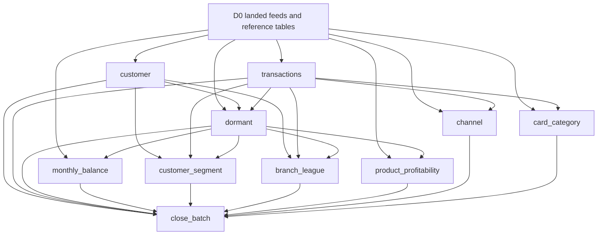

# DAIWT-01 golden-scoped migration plan

## Evidence and scope

Both repositories were already cloned. The read-only manifest at `/Volumes/daiwt_01_mig_prod/landing/golden/manifest.json` is byte-identical to committed `golden/manifest.json`: SHA256 `83a521f98acf631312852ae4b28826c1547e9217f9ab72244a13423dfcda58e7`, capture `20261110T162154Z`, legacy commit `cf4b4fabd3df9c49f724b3087e590b68d28d8ef1`. Scope is exclusively its ten `outputs/D0/` CSVs. The manifest says these are Python reference-control snapshots, not live Teradata executions. No multi-drop or live-engine parity is claimed.

`docs/units.yml` follows the framework workflow's top-level `units` list and builder-plan fields; outputs use exactly `table`, `golden`, `keys` from the runtime schema. Unit names retain manifest job stems because framework names cannot start with a digit; the full legacy job mapping follows below. Paths in legacy_sources are relative to the legacy repo. Golden paths are relative to the golden root, not this checkout. The configured runtime golden root in `estate.yml` is `/Volumes/daiwt_01_mig_prod/migration_ci_fixtures/golden`; this plan does not modify that configuration or claim it was compared with the authoritative landing manifest.

## Dependency graph

Edges are data dependencies, plus all preceding units as release prerequisites for close_batch. The legacy scheduler serializes jobs 01 through 10; dependencies here do not duplicate incidental timing edges. Transactions validates original landed accounts, not the derived dormant account output. Landed reference tables are input prerequisites, not additional output units.

**Execution constraint:** close_batch is silver by its output schema but depends on Gold. The current two-wave workflow blindly starts all Silver first; it cannot run this plan unchanged. A future orchestration step must schedule close_batch after Gold (and honor dependencies within Silver). Do not remove real dependencies or duplicate control-table ownership to fit the wave order.

## Producer and golden ownership

All BTEQ headers and failure handlers update the shared legacy batch table. These are orchestration side effects, not additional ownership: only close_batch materializes the final golden control row. Procedures/macros belong to their invoking unit, not separate writers.

| Legacy job and delegated producer | Unit | Target table | Golden file (relative root) |
| --- | --- | --- | --- |
| `legacy/bteq/01_customer.btq` | `customer` | `silver.dim_customer` | `outputs/D0/customer/dim_customer.csv` |
| `legacy/bteq/02_transactions.btq` | `transactions` | `silver.fct_transaction` | `outputs/D0/transactions/fct_transaction.csv` |
| `legacy/bteq/03_dormant.btq` + `legacy/procs/flag_dormant.sql` | `dormant` | `silver.dim_account` | `outputs/D0/dormant/dim_account.csv` |
| `legacy/bteq/04_monthly_balance.btq` + `legacy/macros/monthly_balance.sql` | `monthly_balance` | `gold.mart_monthly_balance` | `outputs/D0/monthly_balance/mart_monthly_balance.csv` |
| `legacy/bteq/05_customer_segment.btq` + `legacy/procs/customer_segment.sql` | `customer_segment` | `gold.mart_customer_segment` | `outputs/D0/customer_segment/mart_customer_segment.csv` |
| `legacy/bteq/06_branch_league.btq` + `legacy/procs/branch_league.sql` | `branch_league` | `gold.mart_branch_performance` | `outputs/D0/branch_league/mart_branch_performance.csv` |
| `legacy/bteq/07_product_profitability.btq` | `product_profitability` | `gold.mart_product_profitability` | `outputs/D0/product_profitability/mart_product_profitability.csv` |
| `legacy/bteq/08_channel.btq` + `legacy/macros/channel_daily.sql` | `channel` | `gold.mart_channel_daily` | `outputs/D0/channel/mart_channel_daily.csv` |
| `legacy/bteq/09_card_category.btq` + `legacy/macros/card_category.sql` | `card_category` | `gold.mart_card_spend_category` | `outputs/D0/card_category/mart_card_spend_category.csv` |
| `legacy/bteq/10_close_batch.btq` | `close_batch` | `silver.etl_batch_control` | `outputs/D0/close_batch/etl_batch_control.csv` |

## Inputs and out of scope

Input prerequisites from `inputs/D0/`: nvb_stg.customer_feed, nvb_stg.transaction_feed; nvb_edw.dim_account, dim_branch, dim_calendar, dim_merchant, dim_product, fct_daily_balance. Read their landed bronze equivalents; preserve original account input separately from dormant's output. nvb_edw.dim_card, fct_loan and fct_product_order are captured inputs but unused by these ten outputs. No Silver passthrough units are introduced without golden outputs. DDL and column defaults are supporting sources, not independent producers.

Code with no golden output, excluded from migration units:
- `legacy/views/v_customer_portfolio.sql`
- `legacy/views/v_credit_risk.sql`
- `legacy/views/v_channel_trend.sql`
- `reports/branch_league.sql`
- `reports/card_services.sql`
- `reports/finance_monthly.sql`
- `reports/risk_arrears.sql`
- `data/generate.py` and `Makefile`: fixture/setup delivery generation, not target transformations.
- `legacy/schedules/nightly.yaml` jobs `upstream` and `reconcile`, and `legacy/schedules/runbook.md`: external loading/manual release, retention and publication operations, not additional golden-output builders.
- Installation-only `legacy/ddl/*.sql` for input-only tables: customer_feed, transaction_feed, dim_branch, dim_calendar, dim_card, dim_merchant, dim_product, fct_daily_balance, fct_loan, fct_product_order. Necessary input DDL remains reference material.

All ten BTEQ scripts, three procedures and three macros are accounted for above. The existing discovery catalogue describes a broader migration; this plan deliberately excludes its no-golden views/reports/platform units.

## Validation boundaries

Framework 1.0.4 offers `migration-ci check` for implemented `src/units/*/unit.yml`, not a validator for planning documents. Validate this plan's fields, exclusive output ownership, golden/key mapping, source paths and acyclic dependencies against the manifest; run the existing repository tests and framework check as structural checks only. No SQL has been migrated by this documentation change and no runtime parity is implied.
